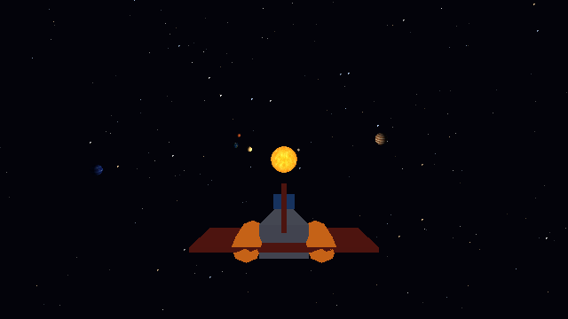
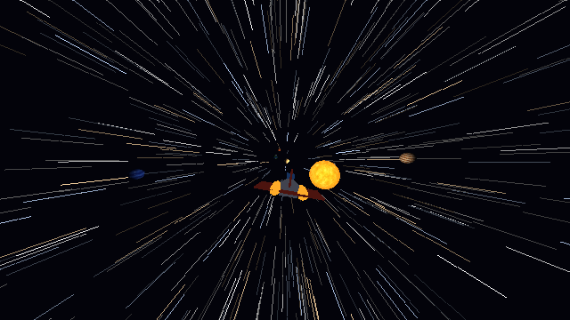
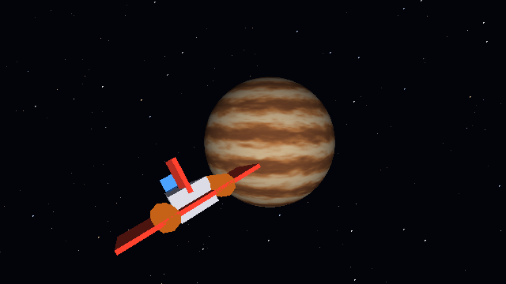

# Proyecto 3 - Zig: Simulación del Sistema Solar (software renderer)

Simulación del sistema solar renderizada **100% por software** en
[Zig](https://ziglang.org/) 0.16. [raylib](https://www.raylib.com/) (vía
[raylib-zig](https://github.com/raylib-zig/raylib-zig)) solo se usa para abrir la
ventana, subir el framebuffer como textura, leer el teclado/mouse y usar sus tipos
de vectores. **Ningún píxel lo dibuja raylib**: lo escribe nuestro rasterizador.

## Video

> Video de la cámara explorando el sistema: **(pendiente: pegar aquí el link)**





## Cómo correr

```sh
zig build run          # compila en ReleaseFast y abre la ventana
zig build test         # pruebas unitarias (no abren ventana)
```

Requiere Zig 0.16.0 y conexión a internet la primera vez (para bajar raylib-zig).

## Controles

| Tecla | Acción |
|---|---|
| Mouse / flechas | Mirar |
| W / S | Avanzar / retroceder (en 3D, hacia donde mira la cámara) |
| A / D | Moverse a los lados |
| Espacio / Ctrl | Subir / bajar |
| Shift | Ir más rápido |
| 1 - 8 | **Viaje rápido**: Sol, Mercurio, Venus, Tierra, Luna, Marte, Júpiter, Neptuno |
| Tab | Viajar al siguiente cuerpo |
| P | Pausar las órbitas |
| B | Activar / desactivar back-face culling |
| V | Activar / desactivar sombras |
| L | Forzar el nivel de detalle más bajo (para ver el LOD) |
| F12 | Guardar captura (`captura.png`) |
| Esc | Salir |

El título de la ventana muestra FPS, triángulos dibujados y el destino actual.

## Cómo está organizado el código

Cada archivo hace una sola cosa:

| Archivo | Qué hace |
|---|---|
| `src/main.zig` | Ventana, bucle principal y entrada. Une todos los módulos. |
| `src/framebuffer.zig` | Imagen RGBA + z-buffer. Es lo único donde "se dibuja". |
| `src/camera.zig` | Cámara libre (yaw/pitch) y la "vista" que usa el rasterizador. |
| `src/controls.zig` | Teclado y mouse: movimiento 3D de la cámara + colisiones. |
| `src/raster.zig` | **Rasterizador**: recorte contra el plano cercano, proyección, back-face culling, z-buffer, llamada al shader por píxel. |
| `src/mesh.zig` | Mallas de triángulos y la esfera con varios niveles de detalle (LOD). |
| `src/obj.zig` | Cargador de `.obj` que acepta caras de cualquier número de lados. |
| `src/solar_system.zig` | Datos de cada cuerpo, sus órbitas, y la colisión (`pushOut`). |
| `src/lighting.zig` | Luz del Sol (Lambert) y **sombras** con penumbra (eclipses). |
| `src/shaders.zig` | Un shader distinto por planeta (ver abajo). |
| `src/renderer.zig` | Recorre los cuerpos, elige el LOD y manda los triángulos al rasterizador. |
| `src/travel.zig` | Viaje rápido con animación (warp). |
| `src/stars.zig` | Skybox de estrellas (y las rayas del warp). |
| `src/ship.zig` | La nave que sigue a la cámara. |
| `src/texture.zig` | Tipo `Texture` y muestreo sobre una esfera. |
| `src/textures_claude.zig` | **Texturas procedurales. Código generado por Claude (IA).** |
| `assets/ship.blend` / `ship.obj` | Modelo de la nave hecho en Blender (quads y octágonos). |

### Pipeline de un triángulo

1. El renderer transforma los vértices al mundo (y aplica el shader de vértices).
2. `raster.zig` los pasa al espacio de la cámara y recorta contra el plano cercano.
3. Proyección perspectiva a pantalla y **back-face culling** (signo del área).
4. Por cada píxel: coordenadas baricéntricas, interpolación con corrección de
   perspectiva, prueba de **z-buffer** y llamada al shader.
5. El shader calcula el color (textura + luz del Sol + sombra + efectos).

## Texturas (código generado por Claude)

Las texturas de **todos** los cuerpos las generó Claude como código en
`src/textures_claude.zig`. No hay imágenes en disco: se calculan al arrancar con
ruido matemático 3D (valor + fbm + Worley para cráteres). Como el ruido es 3D,
las texturas no tienen costuras. El resto del proyecto está escrito aparte y no
depende de cómo se generan.

## Cuerpos celestes y shaders

| Cuerpo | Shader especial |
|---|---|
| Sol | Animado: dos capas de plasma que se mueven en sentidos opuestos, palpita (geometría) y oscurece el borde. No recibe luz: la emite. |
| Mercurio, Luna, Marte | Textura con cráteres / relieve + luz del Sol. |
| Venus | Animado: nubes que se arremolinan y atmósfera que brilla en el borde. |
| Tierra | Reflejo especular en el océano y luces de ciudades en el lado nocturno. |
| Júpiter | Animado: las bandas se desplazan a distinta velocidad según la latitud. |
| Neptuno | **Modifica la geometría**: la superficie ondula con el tiempo. |

## Lista de requisitos

| Requisito | Dónde |
|---|---|
| Sol + planetas + luna orbitando | `solar_system.zig` |
| Texturas distintas por cuerpo | `textures_claude.zig` |
| Shader único por cuerpo | `shaders.zig` |
| El Sol ilumina los planetas | `lighting.zig` (`lambert`) |
| Sombras / eclipses | `lighting.zig` (`shadowAt`) |
| Back-face culling | `raster.zig` (tecla B para verlo) |
| LOD | `renderer.zig` (`pickLod`, 3 niveles; tecla L) |
| Buen rendimiento | Resolución interna 640x360, ~4 ms por cuadro; recorte contra el plano cercano para no atascarse cerca de los objetos |
| Viaje rápido + efecto animado | `travel.zig` + `stars.zig` (FOV y rayas de estrellas) |
| Nave que sigue a la cámara | `ship.zig` |
| Nave modelada en Blender (`.blend`) | `assets/ship.blend` |
| Modelo con caras que no son triángulos | `obj.zig` (quads y octágonos → abanico de triángulos) |
| Skybox con estrellas | `stars.zig` |
| Colisiones (cámara y nave) | `solar_system.zig` (`pushOut`) |
| Cámara con movimiento 3D | `controls.zig` |
